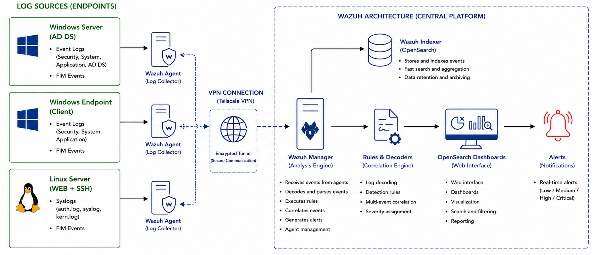
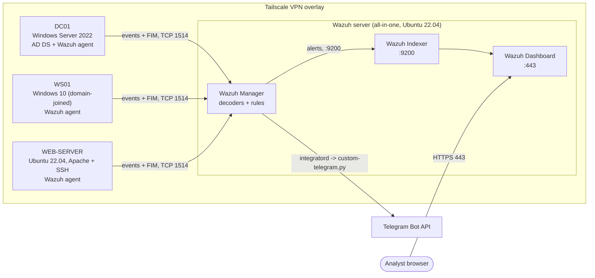
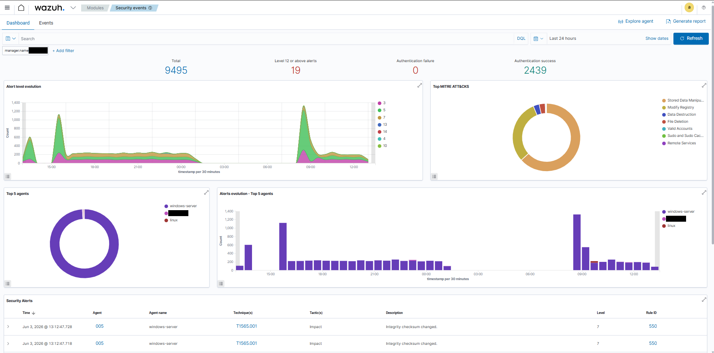
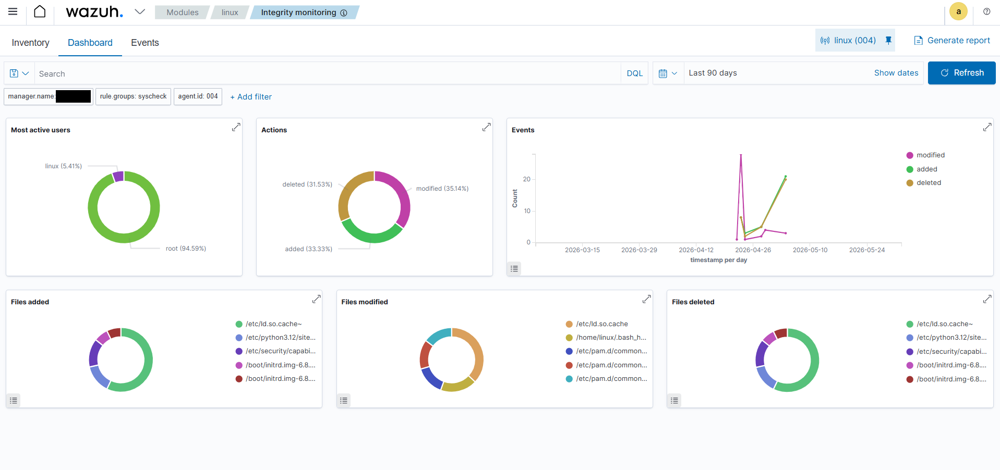
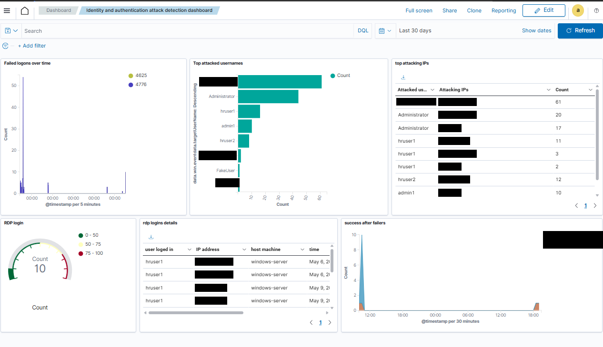
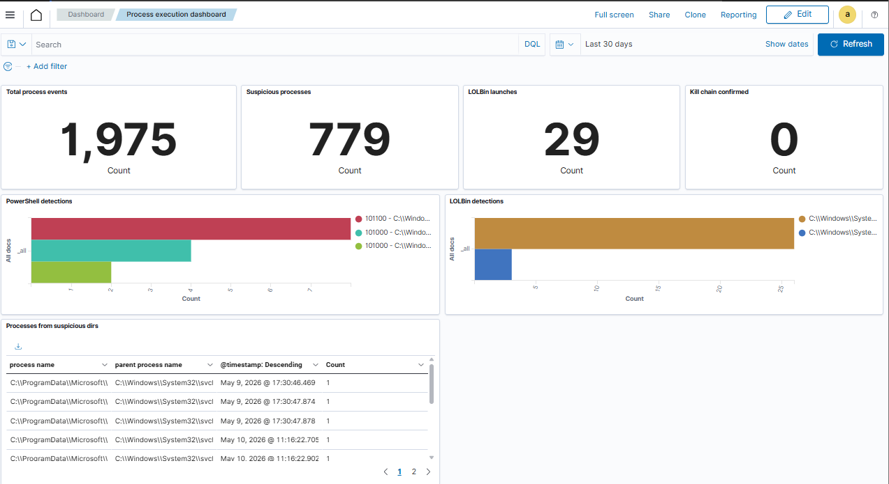
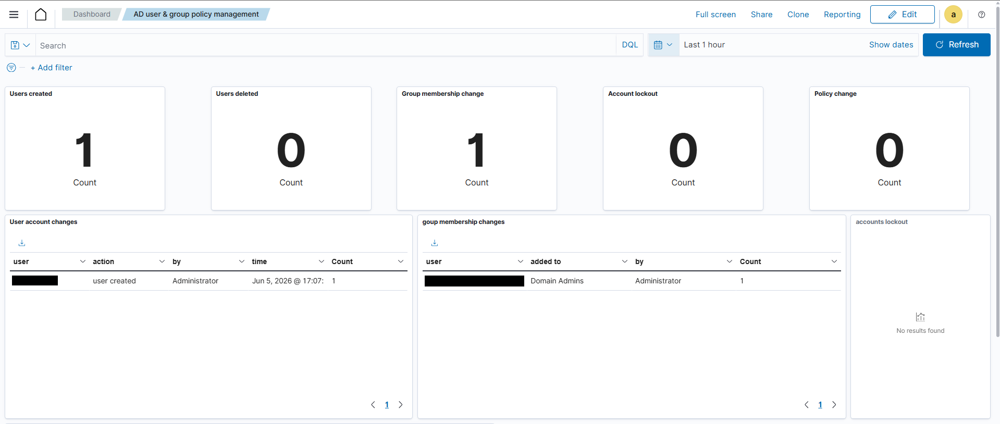
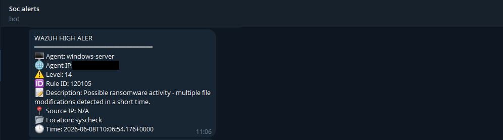

# Wazuh FIM & SIEM Lab

A hands-on, **educational** security-monitoring lab built around [Wazuh](https://wazuh.com): File Integrity Monitoring (FIM) first, then extended into a small centralized SIEM covering Windows, Active Directory and Linux, with custom detection rules, dashboards, Telegram alerting and simulated attack validation.

> **Status:** lab / learning project. Everything was built and exercised in an isolated virtual lab, not in production. See [Limitations](docs/limitations.md) before drawing conclusions about real-world coverage.

---

## Contents

- [Objectives](#objectives)
- [Key features](#key-features)
- [Technologies](#technologies)
- [Architecture overview](#architecture-overview)
- [Monitoring capabilities](#monitoring-capabilities)
- [Detection scenarios](#detection-scenarios)
- [Validation results](#validation-results)
- [Repository structure](#repository-structure)
- [Deployment prerequisites](#deployment-prerequisites)
- [Installation and configuration overview](#installation-and-configuration-overview)
- [Screenshots](#screenshots)
- [Limitations and future improvements](#limitations-and-future-improvements)
- [How to read the provenance tags](#how-to-read-the-provenance-tags)
- [Disclaimer](#disclaimer)

## Objectives

1. Deploy a centralized Wazuh platform acting as both FIM engine and SIEM.
2. Build a small enterprise-like lab: Active Directory domain controller, domain-joined workstation, Linux web server.
3. Monitor sensitive files, directories and persistence-related registry keys on Windows and Linux.
4. Collect and normalize Windows Event Logs and Linux system/authentication/web logs.
5. Write custom detection rules for brute force, account/group changes, PowerShell/process abuse, persistence and ransomware-like behavior.
6. Build dashboards for centralized alert and FIM visibility.
7. Push high-severity alerts to Telegram in near real time.
8. Validate the whole chain with simulated attacks mapped to MITRE ATT&CK.

## Key features

- **All-in-one Wazuh** (Manager + Indexer + Dashboard) on a single Ubuntu server.
- **Three monitored endpoints** enrolled through Wazuh agents over a **Tailscale** VPN overlay.
- **FIM** with real-time monitoring of `/etc`, `/var/www`, `/home` on Linux and of `C:\Users`, `C:\Windows\NTDS`, selected system binaries and persistence registry keys on Windows.
- **Custom rules** for failed/successful logons, brute-force correlation, account compromise, AD user creation, group membership changes, PowerShell activity, suspicious executables and mass file modification.
- **Telegram alerting** through a small Python integration (credentials via environment variables, never in code).
- **Safe, lab-only test helpers** to reproduce each detection without destructive payloads.

## Technologies

| Area | Components |
|---|---|
| SIEM / FIM | Wazuh Manager, Wazuh Indexer, Wazuh Dashboard (all-in-one, 4.x) |
| Servers | Ubuntu Server 22.04 LTS (Wazuh server, Linux web server with Apache + SSH) |
| Windows | Windows Server 2022 (AD DS domain controller), Windows 10 domain-joined workstation |
| Identity | Active Directory Domain Services, Group Policy (audit, password/lockout policy) |
| Connectivity | Tailscale VPN |
| Telemetry | Windows Event Log (Security/System/Application), Linux `auth.log`/`syslog`/Apache logs, Wazuh syscheck (FIM) |
| Automation | Python 3 (`requests`), Telegram Bot API |
| Validation | Atomic Red Team (T1098), simulated brute-force and ransomware-like activity, MITRE ATT&CK mapping |
| Virtualization | VMware Workstation / Oracle VirtualBox |

## Architecture overview



Simplified view (Mermaid):



Details: [docs/architecture.md](docs/architecture.md).

## Monitoring capabilities

| Capability | Windows / AD | Linux |
|---|---|---|
| File integrity (add / modify / delete / permissions) | `C:\Users`, `C:\Windows\NTDS`, selected system binaries | `/etc`, `/var/www`, `/home`, `/bin`, `/sbin`, `/boot` |
| Registry integrity (persistence keys) | `Run` / `RunOnce` keys, selected class keys | n/a |
| Authentication events | 4624 / 4625 (+ RDP logon type 10, Kerberos 4771 on dashboards) | SSH success/failure via `auth.log` |
| Account & group changes | 4720, 4726, 4728 / 4732 / 4756 | new-user creation via stock rules |
| Process creation | 4688 | `syslog` / `auth.log` (sudo, su) |
| Web server | n/a | Apache access and error logs |
| Alerting | Dashboard + Telegram (level >= 8) | Dashboard + Telegram (level >= 8) |

## Detection scenarios

| # | Folder | Scenario | MITRE ATT&CK (from the project) | Key rules |
|---|---|---|---|---|
| 1 | [`01-windows-ransomware-simulation`](attack-scenarios/01-windows-ransomware-simulation/) | Impact phase: mass file modification by a ransomware-like test binary | T1486 | 120104, 120105 |
| 2 | [`02-windows-process-and-persistence`](attack-scenarios/02-windows-process-and-persistence/) | Delivery, execution from a suspicious directory and Run-key persistence | T1059.001, T1105, T1204, T1547.001 | 120100-120103, 101300, FIM registry alert |
| 3 | [`03-active-directory-monitoring`](attack-scenarios/03-active-directory-monitoring/) | Brute force, valid account, new domain user, privileged group change | T1110, T1078, T1136, T1098 | 100110, 100200, 110152, 102020 |
| 4 | [`04-linux-ssh-compromise`](attack-scenarios/04-linux-ssh-compromise/) | SSH brute force, valid account, persistence via new local account | T1110, T1078, T1136 | stock PAM/sshd failure alert, 5902 |

Scenarios 1 and 2 are the two phases of a single ransomware chain in the original project (delivery/execution/persistence, then impact); they are split here for readability.

## Validation results

Results as recorded during the lab exercise (single run per scenario, no latency or false-positive measurement - see [testing-and-validation](docs/testing-and-validation.md)):

| Check | Result |
|---|---|
| Ransomware-like activity | Detected |
| Payload execution | Detected |
| Registry persistence | Detected |
| Mass file-modification activity | Detected |
| AD user creation | Detected |
| Privileged group membership change | Detected |
| Linux SSH compromise | Detected |
| Linux account creation | Detected |
| Telegram notifications | Delivered |

## Repository structure

```
wazuh-fim-siem/
├── README.md
├── LICENSE
├── .gitignore
├── docs/                      # Architecture, deployment, configuration, detection, alerting, testing, limitations
│   ├── source-inventory.md    # What is implemented / tested / proposed / missing
│   └── images/
├── configs/                   # Sanitized configuration excerpts
│   ├── wazuh-manager/
│   ├── linux/
│   └── windows/               # includes the AD audit-policy reference
├── detection-rules/           # Custom rules by platform / purpose
│   ├── windows/
│   ├── active-directory/
│   ├── linux/
│   ├── fim/
│   └── local_rules.documented.xml   # single deployable file
├── integrations/telegram/     # Python integration, wrapper, env template, sample alert
├── scripts/
│   ├── linux/                 # agent install / verify helpers
│   ├── windows/               # agent install, audit policy helper
│   └── testing/               # safe, lab-only detection test helpers
├── attack-scenarios/          # One README per scenario
├── dashboards/                # Dashboard design notes (no exported objects available)
└── screenshots/               # Sanitized screenshots (placeholders + capture checklist)
```

## Deployment prerequisites

- A hypervisor (VMware Workstation or VirtualBox) and an **isolated** lab network.
- Four VMs: Wazuh server (Ubuntu 22.04, 4 vCPU / 8 GB RAM as used in the lab), Windows Server 2022 DC (2 vCPU / 4 GB / 60 GB), Windows 10 workstation, Ubuntu 22.04 web server.
- A Tailscale account with all four machines joined.
- (Optional) A Telegram bot and a chat that receives alerts.
- Python 3 with `requests` on the Wazuh server for the Telegram integration.

## Installation and configuration overview

1. Provision the four VMs and join them to the Tailscale network.
2. Install Wazuh all-in-one on the server (`wazuh-install.sh -a`).
3. Promote the Windows Server to a domain controller, create OUs/accounts, configure audit and password/lockout GPOs, join the workstation.
4. Enroll the three agents (dashboard-generated install command; manager port 1514, enrollment 1515).
5. Apply the agent configurations in [`configs/`](configs/) (event channels, `localfile`, `syscheck`).
6. Deploy [`detection-rules/local_rules.documented.xml`](detection-rules/local_rules.documented.xml) to `/var/ossec/etc/rules/local_rules.xml` and restart the manager.
7. (Optional) Install the Telegram integration from [`integrations/telegram/`](integrations/telegram/).
8. Reproduce the scenarios with the helpers in [`scripts/testing/`](scripts/testing/).

Full steps: [docs/deployment-guide.md](docs/deployment-guide.md) and [docs/configuration-guide.md](docs/configuration-guide.md).

## Screenshots

Sanitized captures from the lab (IPs, hostnames, domains and account names redacted). Full index: [`screenshots/README.md`](screenshots/README.md).

| | |
|---|---|
|  |  |
| Security events with MITRE ATT&CK view (Windows server) | Integrity monitoring dashboard (Linux web server) |
|  |  |
| Custom identity / authentication attack dashboard | Custom process execution and PowerShell dashboard |
|  |  |
| Custom AD dashboard after one attack run | Telegram alert for rule 120105 |

## Limitations and future improvements

Main limitations: virtualized lab with four hosts, single all-in-one node (no HA/cluster), simplified attack scenarios, some rule definitions referenced by the dashboards were not recorded, and no quantitative detection metrics. Planned/possible improvements from the project: Sysmon on Windows, threat-intelligence enrichment, Active Response (IP blocking, host isolation) and a clustered deployment.

Full list: [docs/limitations.md](docs/limitations.md).

## How to read the provenance tags

Because this repository was reconstructed from project documentation, content is tagged by origin:

| Tag | Meaning |
|---|---|
| **[Documented]** | Taken from the project documentation (rule XML, config excerpts, commands, tables). Sanitized only. |
| **[Validated]** | Documented **and** shown to fire during a lab attack scenario. |
| **[Recommendation]** | Added for completeness or safety. **Not** part of the original project. |
| **[Not recorded]** | Referenced by the project but the definition/content was not available. Not recreated. |

## Disclaimer

This is an educational cybersecurity project. Use the material **only** on systems you own or are explicitly authorized to test. The attack-simulation notes describe activity inside an isolated lab; no malware, payloads or offensive tooling are included, and the test scripts are deliberately benign. All hostnames, domains, IP addresses and accounts in this repository are placeholders. Nothing here is a guarantee of detection coverage in a real environment; the authors accept no liability for use or misuse.
