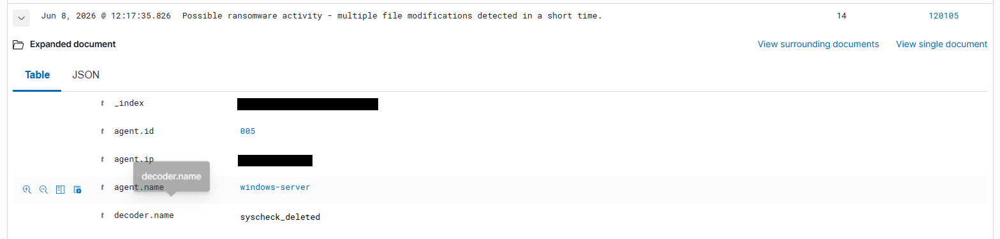
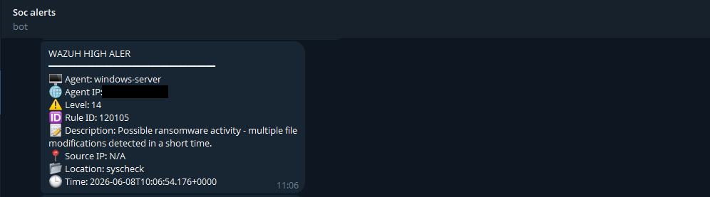
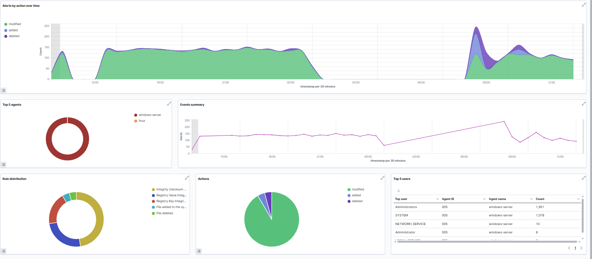

# 01 - Windows ransomware simulation (impact phase)

## Objective
Verify that Wazuh flags the *impact* of ransomware-like behavior: a large number of file modifications in a short time on a Windows endpoint. **[Documented]**

## Lab environment
The Windows Server 2022 VM (agent label `windows-server`, placeholder `DC01` in the docs) with the Wazuh agent and FIM enabled on user directories (real time); manager with custom rules 120104/120105; Telegram integration active. See [../README.md](../README.md).

## MITRE ATT&CK mapping
| ID | Technique |
|---|---|
| T1486 | Data Encrypted for Impact |

(The delivery, execution and persistence techniques of the same chain are in [scenario 02](../02-windows-process-and-persistence/).)

## Simulation steps (lab only)
1. In the original exercise a ransomware-like test executable was run on the Windows Server VM. It encrypted several files (37, per the on-screen counter) and displayed a ransom screen. **[Documented]** The binary, how it was obtained and how it works are intentionally **not** included.
2. The encryption produced a large number of file modifications within a short time. **[Documented]**
3. **[Recommendation]** To reproduce the *telemetry* safely, use [`scripts/testing/windows-fim-burst.ps1`](../../scripts/testing/windows-fim-burst.ps1), which creates and edits dummy files in a monitored test folder and cleans up afterwards. No encryption is involved.

## Expected telemetry
Wazuh syscheck (FIM) events for file creation/modification in monitored paths (real-time mode on `C:\Users`, plus the dedicated test directory).

## Detection logic
```xml
<rule id="120104" level="6"><if_group>syscheck</if_group> ... </rule>
<rule id="120105" level="14" frequency="30" timeframe="60">
  <if_matched_sid>120104</if_matched_sid> ...
</rule>
```
30 FIM events within 60 seconds escalate to a level-14 alert. Full XML: [`detection-rules/fim/fim-correlation.xml`](../../detection-rules/fim/fim-correlation.xml); analysis: [detection-engineering](../../docs/detection-engineering.md).

## Expected Wazuh alert
Rule **120105** - "Possible ransomware activity - multiple file modifications detected in a short time" (level 14), plus a Telegram notification (level >= 8).

## Actual validation result **[Validated]**
Alert 120105 was generated at level 14 and a Telegram notification was received. File-encryption activity was reported as detected.

## Screenshots

*Lab test binary's screen (cropped; wallet and contact details removed).*


*Alert 120105 document (level 14).*


*Telegram notification (sanitized).*


*FIM / registry integrity dashboard for the Windows server.*

All images are sanitized; index in [../../screenshots/README.md](../../screenshots/README.md).

## Defensive analysis and lessons learned
Reported by the project:
- FIM plus a frequency-based correlation rule is enough to catch the *loud* part of ransomware (mass modification) quickly, and Telegram shortens time to awareness.

Additional observations **[Recommendation]**:
- This detects impact, not prevention: by the time 120105 fires, files are already being changed. Pair it with early-stage detections (scenario 02) and offline backups.
- The rule is not scoped to an agent or path; legitimate bulk changes can trigger it, and a slow encryptor can stay under 30 events/minute. Tune per host and consider honeypot (canary) files.
- The 60 s FIM scan interval and real-time mode affect how fast events appear; confirm real-time works on your monitored paths.
