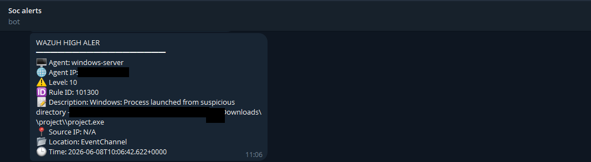
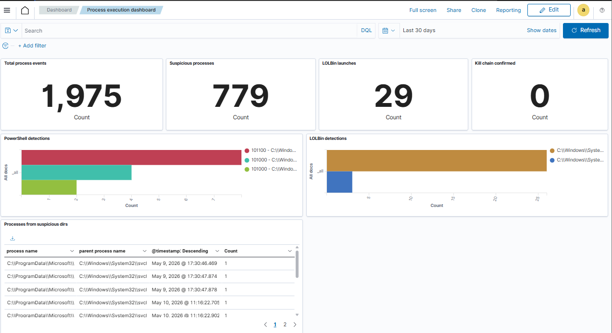
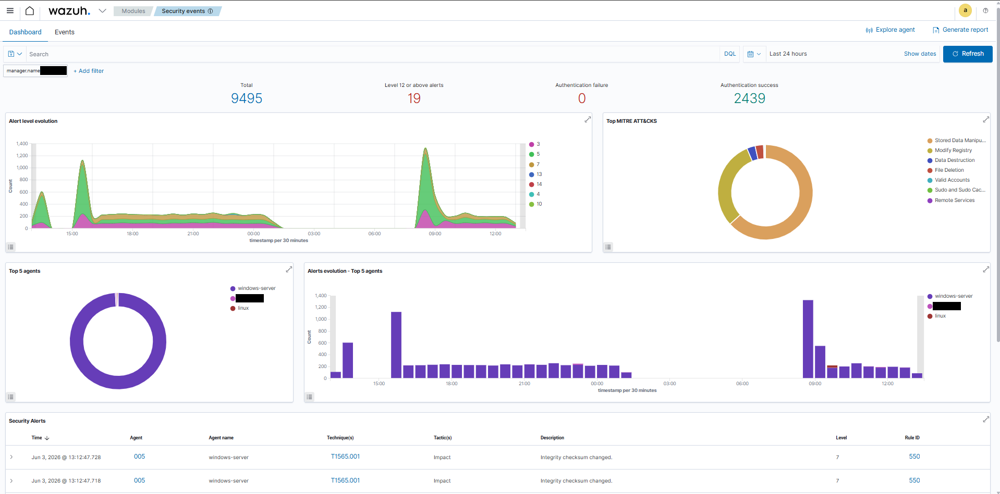

# 02 - Windows process execution and persistence

## Objective
Verify detection of the *early* ransomware-chain stages on Windows: PowerShell-based payload delivery, execution of an unknown binary from a user-writable directory, and Run-key persistence. **[Documented]**

## Lab environment
Windows Server 2022 VM (agent label `windows-server`, placeholder `DC01`) with the Wazuh agent, event-channel collection and FIM (including `Run`/`RunOnce` registry keys); custom rules 120100-120103 plus the unrecorded rule 101300; Telegram integration.

## MITRE ATT&CK mapping **[Documented]**
| ID | Technique |
|---|---|
| T1059.001 | PowerShell |
| T1105 | Ingress Tool Transfer |
| T1204 | User Execution |
| T1547.001 | Registry Run Keys / Startup Folder |

## Simulation steps (lab only)
1. A PowerShell command downloaded a compressed archive containing a test executable from a remote server and launched it. **[Documented]** The command, host and payload are intentionally **not** included.
2. The test executable (`project.exe`) ran from the user's Downloads folder, which is the path the alert reports. **[Documented]**
3. The program created a value under `HKCU\Software\Microsoft\Windows\CurrentVersion\Run` to survive reboots. **[Documented]**
4. **[Recommendation]** To reproduce the persistence telemetry harmlessly: [`scripts/testing/windows-run-key-test.ps1`](../../scripts/testing/windows-run-key-test.ps1) (benign value pointing at notepad, removed afterwards).

## Expected telemetry
- Process creation events for PowerShell and for the executable (Event 4688 / process-creation telemetry).
- Syscheck registry-modification events for the Run key.

## Detection logic
| Rule | Logic | Level |
|---|---|---|
| 120100 | PowerShell process (`powershell.exe`) | 8 |
| 120101 | ...plus `Invoke-WebRequest` | 12 |
| 120102 | ...plus `curl.exe` | 12 |
| 120103 | Process text contains `project.exe` (lab binary name) | 10 |
| 101300 | Process launched from a suspicious directory (Temp/AppData/Downloads) - **[Not recorded]** XML, alert shown in the project | 10 |
| syscheck | Registry value change in monitored Run key | stock |

XML: [`detection-rules/windows/process-and-powershell.xml`](../../detection-rules/windows/process-and-powershell.xml).

## Expected Wazuh alert
`Rule ID: 101300 - Windows: Process launched from suspicious directory` (level 10) with a Telegram notification; a FIM registry-modification alert for the Run key. 120100-120103 are expected to fire for the PowerShell/download/executable events when the parent telemetry exists.

## Actual validation result **[Validated]**
Reported as detected: payload download activity, malware execution (alert 101300 shown), and registry persistence (FIM). Telegram notification shown for the suspicious-process alert.

## Screenshots

*Telegram alert for rule 101300 (sanitized).*

*Process execution and PowerShell dashboard.*

*Security events and MITRE ATT&CK view for the Windows server (the registry-modification and file-integrity activity appears in the technique breakdown).*

Index: [../../screenshots/README.md](../../screenshots/README.md).

## Defensive analysis and lessons learned
Reported: custom rules plus FIM detected download, execution and persistence; Telegram gave immediate awareness.

Additional observations **[Recommendation]**:
- Detecting by filename (`project.exe`) does not generalize; execution-from-user-writable-path (101300-style) and PowerShell download indicators are more durable, but need the missing XML to be recreated and tested.
- Encoded-command detection (101100) is documented but disabled until its parent rule exists.
- Rules need process telemetry with command lines (enable command-line auditing, or add Sysmon as the project suggests).
- Run-key monitoring catches one persistence mechanism; scheduled tasks, services, WMI and startup folders need their own coverage.
