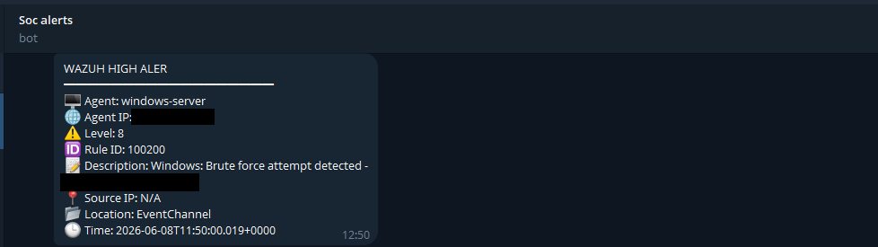
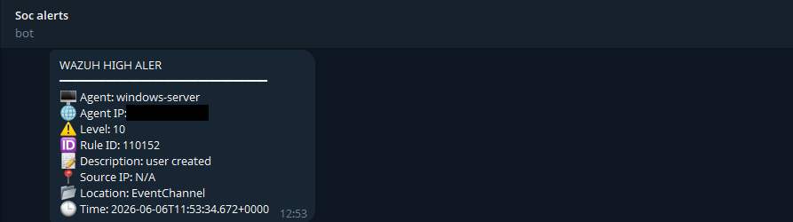
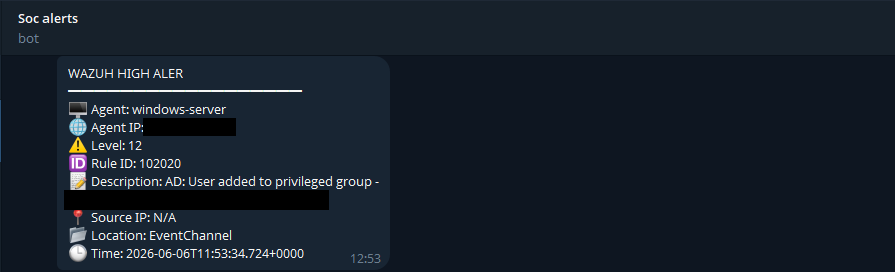
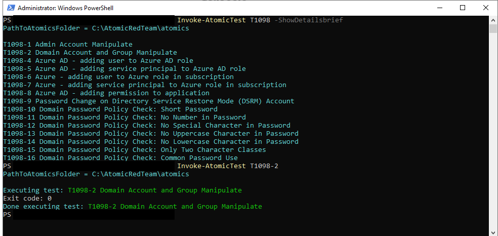
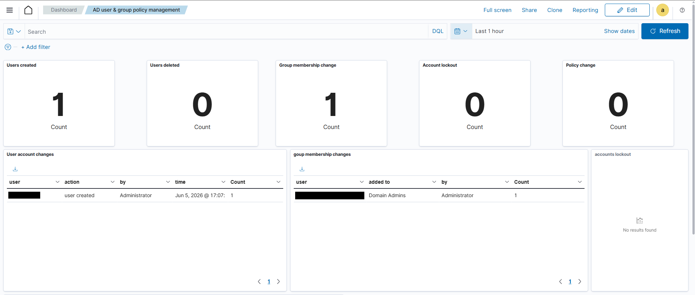
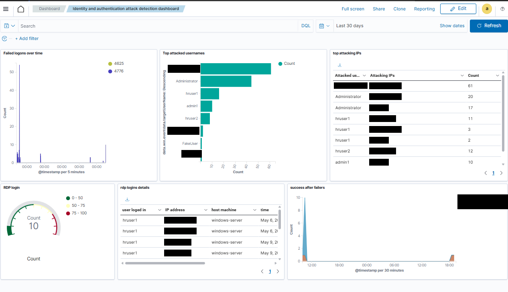

# 03 - Active Directory monitoring (compromise chain)

## Objective
Show that Wazuh detects each stage of a simple AD compromise: password guessing -> valid credentials -> new domain account -> privilege escalation through group membership. **[Documented]**

## Lab environment
Domain controller `DC01` (Windows Server 2022, AD DS, Wazuh agent), domain-joined workstation `WS01`, audit and lockout GPOs configured ([`configs/windows/ad-audit-policy.md`](../../configs/windows/ad-audit-policy.md)), rules 100110/100200/110152/102020, AD dashboard, Telegram.

## MITRE ATT&CK mapping **[Documented]**
| ID | Technique |
|---|---|
| T1110 | Brute Force |
| T1078 | Valid Accounts |
| T1136 | Create Account |
| T1098 | Account Manipulation |

## Simulation steps (lab only)
1. **Brute force:** Hydra was run against a domain account to generate repeated failed authentications until valid credentials were found. **[Documented]** Command lines and wordlists are intentionally not reproduced. Benign alternative **[Recommendation]**: [`windows-failed-logon-burst.ps1`](../../scripts/testing/windows-failed-logon-burst.ps1) (one fixed wrong password, test account only; mind the 5-attempt lockout).
2. **Valid credentials:** the attacker authenticated successfully into the domain. **[Documented]**
3. **New user:** a new domain account was created. **[Documented]**
4. **Atomic Red Team:** `Invoke-AtomicTest T1098` simulated unauthorized privilege/group manipulation (T1098). **[Documented]** The screenshot shows the technique's test list (`-ShowDetailsBrief`) and then test **T1098-2** (*Domain Account and Group Manipulate*) being executed with exit code 0. Run the matching cleanup (`Invoke-AtomicTest T1098-2 -Cleanup`) afterwards **[Recommendation]**.
5. **Escalation:** the new account was added to a privileged AD group. **[Documented]**
6. **[Recommendation]** Safe reproduction of steps 3 and 5: [`windows-ad-user-group-test.ps1`](../../scripts/testing/windows-ad-user-group-test.ps1) (disabled user, dedicated unprivileged group, cleanup).

## Expected telemetry
Security log on the DC: 4625 (failures), 4624 (success), 4720 (user created), 4728/4732/4756 (group member added); lockout events if the threshold is exceeded.

## Detection logic
| Stage | Rule | Logic |
|---|---|---|
| Brute force | 100110 -> 100200 | 5 failures per target user in 300 s |
| Account creation | 110152 | Event 4720 |
| Group change | 102020 | Events 4728/4732/4756 |
| (Compromise after failures) | 100700 | Success correlated with 100200 - not shown firing |

XML: [`windows/authentication.xml`](../../detection-rules/windows/authentication.xml), [`active-directory/account-and-group-changes.xml`](../../detection-rules/active-directory/account-and-group-changes.xml).

## Expected Wazuh alerts
`100200` Windows: Brute force attempt detected - `110152` User Created - `102020` AD: User added to privileged group (level 12), each with a Telegram message (level >= 8).

## Actual validation result **[Validated]**
Reported: brute force detected (alert 100200 + Telegram), user creation detected (110152), privileged-group change detected (102020), and the AD dashboard confirmed the new account and the group change. Chain detected end to end: brute force -> valid account -> user creation -> privileged group.

## Screenshots

*Brute-force alert 100200.*

*User-created alert 110152 (level 10).*

*Privileged-group alert 102020 (level 12).*

*Atomic Red Team T1098 listing and test execution.*

*AD dashboard, 1-hour view: one user created, one group membership change.*

*Identity and authentication dashboard (failed logons, top targeted usernames).*

Index: [../../screenshots/README.md](../../screenshots/README.md).

## Defensive analysis and lessons learned
Reported: GPO-driven auditing is the foundation - without the right audit categories the events do not exist; dedicated AD rules plus a dashboard give fast visibility into account abuse.

Additional observations **[Recommendation]**:
- The successful logon after the brute force (T1078) is the most important pivot; the 100700 correlation exists but has no shown validation, so verify it.
- 102020 triggers on any security group addition; scope it to privileged groups to cut noise.
- Per-user counting misses password spraying across many accounts from one IP; consider a per-source-IP rule.
- Lockout policy helps contain guessing but produces its own events worth alerting on.
