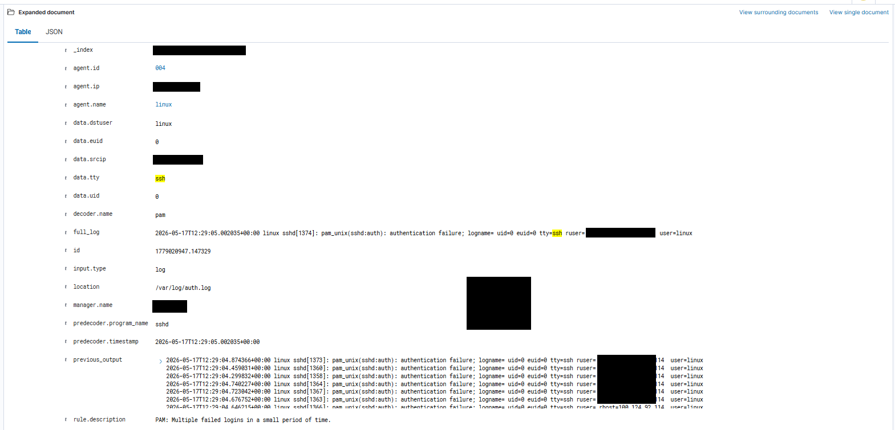
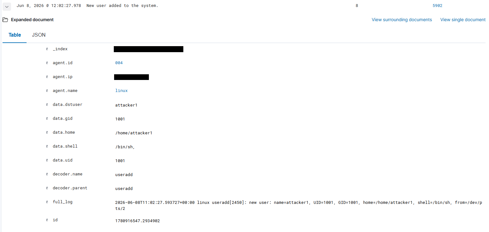
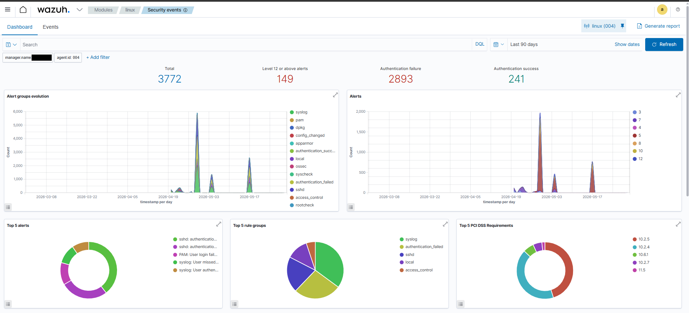
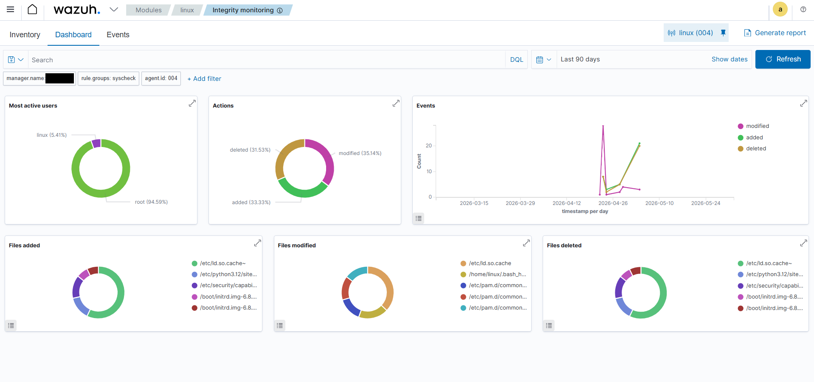

# 04 - Linux SSH compromise and persistence

## Objective
Validate detection of an attacker gaining SSH access to a Linux server by password guessing, then creating a secondary account for persistence. **[Documented]**

## Lab environment
`WEB-SERVER` (Ubuntu 22.04, Apache + SSH, Wazuh agent) collecting `auth.log`/`syslog`, FIM on `/etc`, `/var/www`, `/home`; stock Wazuh sshd decoders/rules; Telegram integration.

## MITRE ATT&CK mapping **[Documented]**
| ID | Technique |
|---|---|
| T1110 | Brute Force |
| T1078 | Valid Accounts |
| T1136 | Create Account |

## Simulation steps (lab only)
1. **SSH brute force:** Hydra was used against the exposed SSH service until valid credentials were found. **[Documented]** Command lines and wordlists are intentionally not reproduced. Benign alternative **[Recommendation]**: [`linux-failed-ssh-burst.sh`](../../scripts/testing/linux-failed-ssh-burst.sh) (fixed wrong password, test user, capped count).
2. **Valid account:** the attacker logged in over SSH with the discovered credentials. **[Documented]**
3. **Persistence:** a secondary local account was created. **[Documented]**
   ```bash
   sudo useradd attacker1
   ```
   Benign, self-cleaning equivalent **[Recommendation]**: [`linux-create-test-user.sh`](../../scripts/testing/linux-create-test-user.sh).

## Expected telemetry
`auth.log` lines for failed and accepted SSH logins (decoded by the stock sshd decoder into `user`, `srcip`, `srcport`) and for the user-creation event; FIM events on `/etc/passwd` and `/etc/shadow` are also expected **[Recommendation: expectation, not shown in the project]**.

## Detection logic
No custom Linux rules: stock sshd/PAM authentication-failure rules (repeated failures raise a "PAM: Multiple failed logins in a small period of time" alert, as shown in the evidence), stock rule 5715 for success, and stock rule 5902 for new users. See [`detection-rules/linux/README.md`](../../detection-rules/linux/README.md).

## Expected Wazuh alerts
`PAM: Multiple failed logins in a small period of time` (stock; rule ID not visible in the evidence), then `5902 - New user added to the system` (level 8); Telegram messages for alerts at level >= 8.

## Actual validation result **[Validated]**
Reported as detected: the SSH compromise activity, use of valid credentials, creation of the new account (rule 5902 shown) and the resulting persistence.

## Screenshots

*Alert document: repeated SSH authentication failures against the `linux` agent (PAM decoder, `/var/log/auth.log`).*


*Rule 5902: `useradd` created `attacker1` (UID/GID 1001, `/bin/sh`).*


*Security events for the Linux agent (sshd/PAM failures dominate).*


*Integrity monitoring dashboard for the Linux agent.*

Index: [../../screenshots/README.md](../../screenshots/README.md).

## Defensive analysis and lessons learned
Reported: Wazuh's built-in Linux rules plus agent log collection were sufficient to track the compromise from brute force to persistence.

Additional observations **[Recommendation]**:
- Rule 5715 (success) is low severity (3), so a successful login right after many failures is easy to overlook; a "success after failures" rule is the natural next step.
- Prevention matters as much as detection: key-only SSH, disabling password auth, rate limiting/fail2ban, and not exposing SSH.
- Alert on persistence beyond `useradd`: `authorized_keys`, sudoers, cron and systemd units via FIM.
