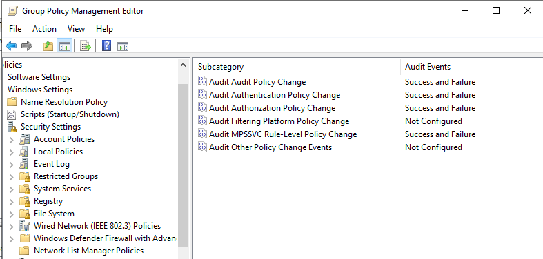

# Active Directory audit, password and lockout policy

Reference for the Group Policy settings that generate the Windows events Wazuh consumes. **[Documented]** - recorded as tables in the project documentation (configured in the GUI; no scripts were recorded).

Without these audit categories, many events used by the rules (for example process creation 4688) are **never generated**, so Wazuh has nothing to collect.

## Advanced audit policy (Default Domain Controllers Policy)

GPMC path: *Computer Configuration > Policies > Windows Settings > Security Settings > Advanced Audit Policy Configuration > Audit Policies*

| Audit category | Setting | Events |
|---|---|---|
| Logon events | Success and Failure | 4624, 4625 |
| Account management | Success and Failure | 4720, 4726, 4732 |
| Process creation | Success | 4688 |
| Policy change | Success and Failure | 4719 |
| Privilege use | Success and Failure | 4672, 4673 |
| Object access | Success and Failure | 4663 |
| Directory service access | Success and Failure | 4662 |



## Password and account lockout policy (Default Domain Policy)

| Setting | Value |
|---|---|
| Minimum password length | 8 characters |
| Password complexity | Enabled |
| Maximum password age | 90 days |
| Account lockout threshold | 5 invalid attempts |
| Account lockout duration | 10 minutes |
| Reset lockout counter after | 10 minutes |

> Note: with a lockout threshold of 5, a brute-force test that exceeds 5 failures against one account will also lock it (and generate lockout events used by the AD dashboard).

## Workstation domain-join prerequisites **[Documented]**

1. DNS on the workstation pointed at the domain controller.
2. Domain controller firewall allows DNS (53), Kerberos (88), LDAP (389) and SMB (445) from the workstation.
3. Tailscale active on both machines.

## OU layout **[Documented, names generalized]**

```
corp.example.local
└── LabOrg (top-level OU)
    ├── AdminUsers   - privileged administrator accounts
    ├── Computers    - joined endpoints
    ├── Groups       - department groups (e.g. HR, IT, Admins, Mail)
    └── Users        - standard user accounts
```

A set of lab accounts (domain admin, IT and HR users, a service account, a backup admin, a security auditor, a test account and an attack-simulation account) was created. Account names are intentionally not listed here.

## [Recommendation] Process command-line auditing

Rules that match on the process command line (for example the PowerShell rules) need the command line to be present in event 4688. Enable *Administrative Templates > System > Audit Process Creation > Include command line in process creation events*. The project documentation does not record this setting; verify it in your own lab.
