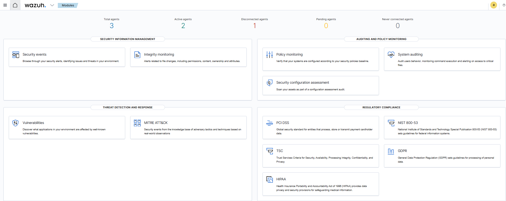
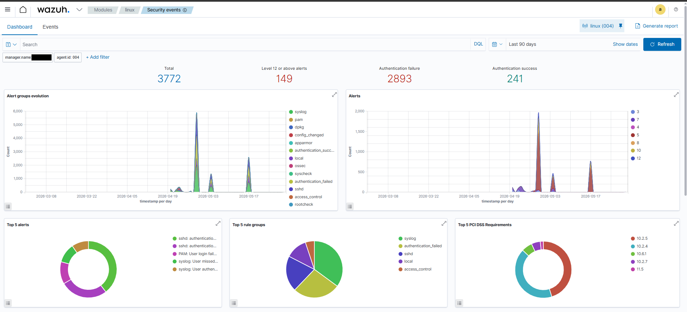
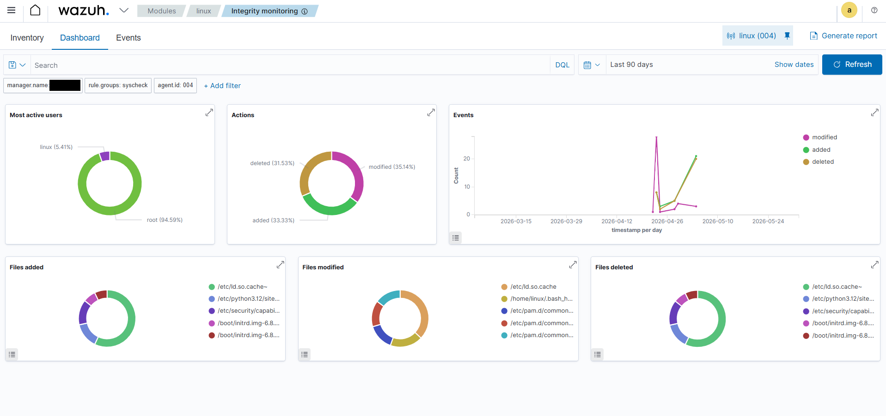
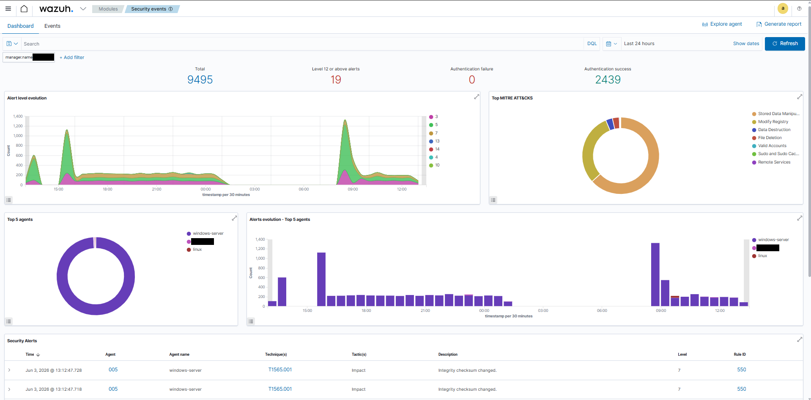
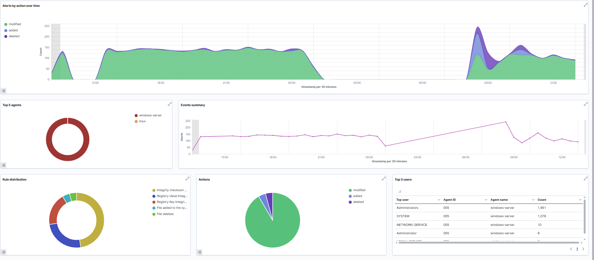
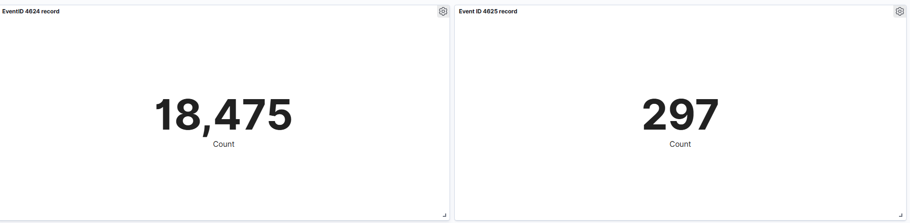
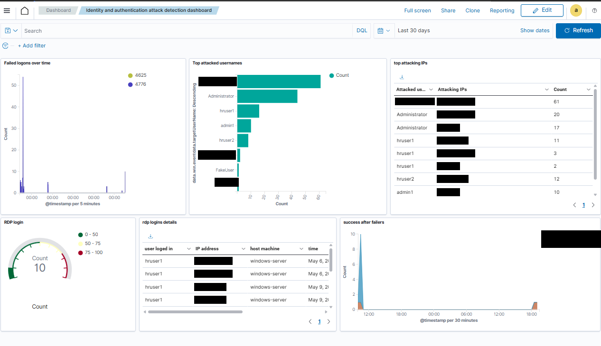
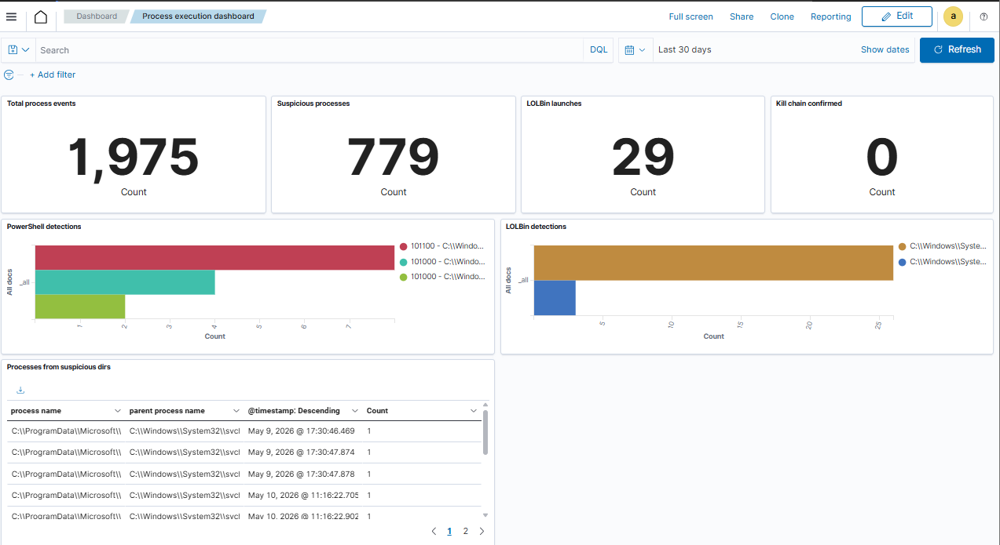
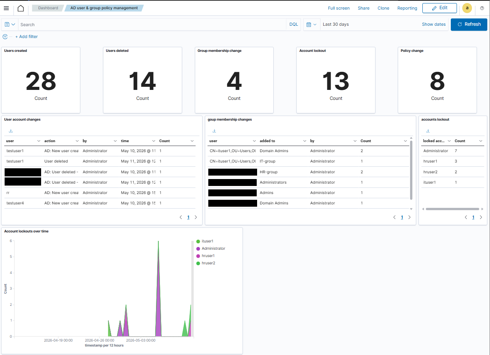

# Dashboards

The project built five dashboards on the Wazuh Dashboard (OpenSearch Dashboards): two stock modules used as-is and three custom ones. **No saved-object exports were available**, so none are included; this page records the design so they can be rebuilt. **[Documented design, Not recorded exports]**

## Stock modules used

| Dashboard | Main panels |
|---|---|
| Security events | Total events, alerts level >= 12, auth failure/success counters, alert-group evolution, top 5 alerts, top 5 rule groups, PCI DSS requirements |
| Integrity monitoring | FIM event timeline, action distribution (added/modified/deleted), most-modified paths, sortable alert table; filter by `agent.id` |

Examples: 

## Custom dashboards
### Identity and authentication
Failed logons over time (4625, Kerberos pre-auth failure 4771), most targeted usernames, top attacking IPs, RDP logon count (logon type 10), successful logons after failures, RDP detail table.
Rules: 100110, 100111 (not recorded), 100200, 100700.

### Process execution and PowerShell
Total process events, suspicious-process counter, LOLBin launches (certutil, mshta, rundll32), PowerShell detections (hidden window, bypass flags, encoded commands), LOLBin chart, processes started from Temp/AppData/Downloads.
Rules: 100900, 101002, 101100, 101200, 101201, 101300 (most **not recorded**, see [detection-engineering](../docs/detection-engineering.md)). The screenshot also shows a "Kill chain confirmed" counter whose logic was not recorded, and a rule 101000 in the PowerShell legend.

### Active Directory users and groups
Users created, users deleted, privileged group changes, account lockouts, policy (GPO) changes, lockouts over time.
Rules: 110152, 110153 (not recorded), 102020, 110100/110101/110102 (not recorded).

## [Recommendation] Exporting for this repo
In Dashboard Management > Saved objects, export each dashboard with its visualizations and index patterns as `.ndjson` into this folder. Review the files first: they can contain hostnames, IPs and usernames from your lab.
