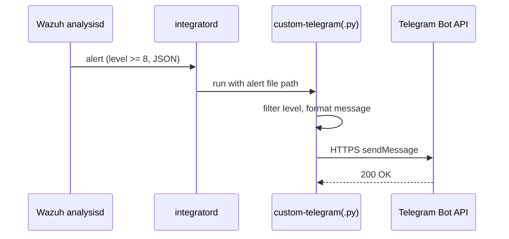
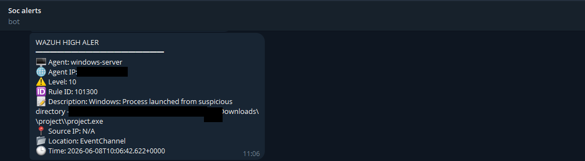
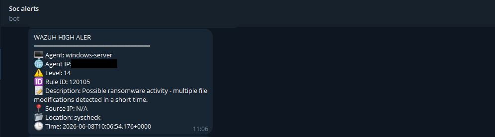
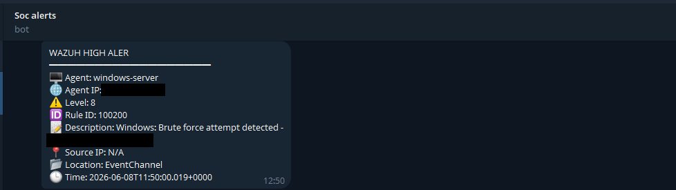

# Alerting integration (Telegram)

## Design **[Documented]**



A custom Python script run by the Wazuh Manager's integration daemon formats alerts and posts them to a dedicated Telegram chat through a bot. It was adapted from a community implementation. Fields sent: agent name, agent IP, level, rule ID, description, source IP, location and timestamp.

The manager enables it with:

```xml
<integration>
  <name>custom-telegram</name>
  <level>8</level>
  <alert_format>json</alert_format>
</integration>
```

## What is in this repository

| Item | Status |
|---|---|
| [`custom-telegram.py`](../integrations/telegram/custom-telegram.py) | **[Documented]** transcription of the project's script, credentials externalized |
| Shell wrapper `custom-telegram` | **[Recommendation]** |
| Env template, systemd drop-in, sample alert | **[Recommendation]** |

The original script had its token masked and a chat ID in clear text in the source. **Neither is reproduced.** If you ever pasted a real token anywhere public, revoke it (`/revoke` in BotFather).

## Credential handling

- Token and chat ID come from `TELEGRAM_BOT_TOKEN` and `TELEGRAM_CHAT_ID` environment variables; the repo ships only [`telegram.env.example`](../integrations/telegram/telegram.env.example).
- Keep the real env file root-owned with mode 600, outside the repo (`.gitignore` also blocks `*.env`).
- The script does not print the request URL (it embeds the token).

## Operations

- Logs: `/var/ossec/logs/integrations.log`.
- Threshold: `<level>` in `ossec.conf` (manager-side) and `TELEGRAM_MIN_LEVEL` (script-side). The effective threshold is the higher of the two.
- Noisy rules (for example frequently firing level-8 alerts) can flood a chat; raise the level or add `<rule_id>` filters to the `<integration>` block **[Recommendation]**.
- Alerts contain hostnames, usernames and IPs: use a private chat.

## Delivery results **[Validated]**

Telegram messages were received for scenario alerts (suspicious process 101300, ransomware-like 120105, brute force 100200, and others). See [testing-and-validation.md](testing-and-validation.md).

Examples (sanitized): 





Setup steps: [`integrations/telegram/README.md`](../integrations/telegram/README.md).
