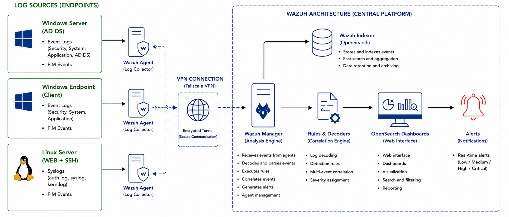
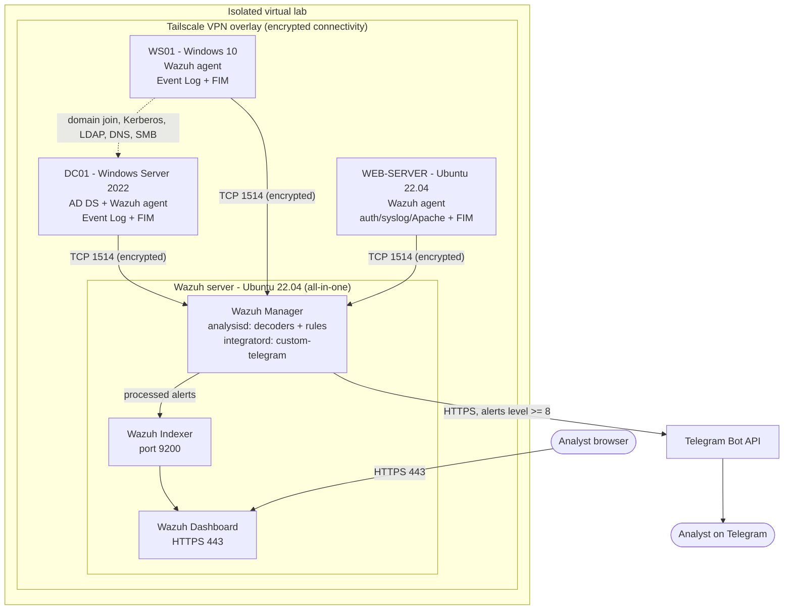
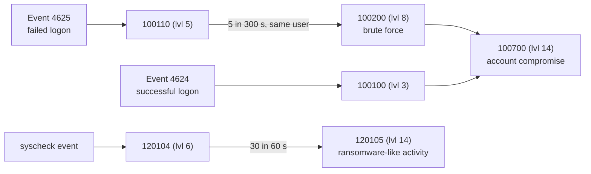

# Architecture

Provenance tags used below: **[Documented]**, **[Validated]**, **[Recommendation]**, **[Not recorded]** (see the [README](../README.md#how-to-read-the-provenance-tags)).

## 1. Overview

The lab simulates a small enterprise with mixed Windows and Linux systems. One central Wazuh server collects, analyzes, indexes and visualizes security telemetry from three monitored endpoints. **[Documented]**

| Role | OS | Purpose |
|---|---|---|
| Wazuh server (all-in-one) | Ubuntu Server 22.04 LTS, 4 vCPU, 8 GB RAM | Manager + Indexer + Dashboard |
| Domain controller (`DC01`) | Windows Server 2022 Standard, 2 vCPU, 4 GB RAM, 60 GB disk | AD DS, authentication, GPO audit policy |
| Workstation (`WS01`) | Windows 10, domain-joined | Simulated user endpoint |
| Web server (`WEB-SERVER`) | Ubuntu Server 22.04 LTS | Apache + SSH, Linux telemetry source |

Virtualization: VMware Workstation and Oracle VirtualBox. Hostnames above are placeholders.

## 2. Diagram

Overview diagram from the lab documentation:

Detailed view (Mermaid):

## 3. Central Wazuh server

All three Wazuh components run on the same host (Wazuh quickstart, all-in-one). **[Documented]** This suits a small lab and simplifies administration; it does not provide high availability or load distribution.

- **Wazuh Manager** - receives agent data, runs decoders and rules, generates alerts, runs integrations. Main config: `/var/ossec/etc/ossec.conf`. Custom rules: `/var/ossec/etc/rules/local_rules.xml`. Stock decoders/rules: `/var/ossec/ruleset/`. **[Documented]**
- **Wazuh Indexer** - stores and indexes alerts and events. Manager-to-indexer traffic uses port 9200. **[Documented]**
- **Wazuh Dashboard** - web UI (built on OpenSearch Dashboards) reached over HTTPS on port 443; hosts the default modules (Security events, Integrity monitoring, Agents, MITRE ATT&CK, Vulnerabilities) and the custom dashboards. **[Documented]**

The manager itself also collects its own `/var/log/auth.log` and `/var/log/syslog`. Only minor manager-side changes were made; most monitoring configuration lives on the agents. **[Documented]**

## 4. Monitored endpoints

### 4.1 Linux web server
Ubuntu 22.04 running Apache and SSH. Collected: `auth.log`, `syslog`, Apache `access.log` / `error.log` (plus `dpkg.log`, `kern.log`, and Wazuh `active-responses.log` per the agent config). FIM covers `/etc`, `/var/www`, `/home`, `/bin`, `/sbin`, `/boot`. **[Documented]**

### 4.2 Windows Server 2022 domain controller
AD DS role; forest and domain functional level Windows Server 2016. Collected channels: Security, System, Application. Key event IDs: 4624, 4625, 4688, 4720, 4732 (and 4726, 4728, 4756, 4719, 4672, 4673, 4663, 4662 via audit policy). FIM includes `C:\Windows\NTDS`, `C:\Users` and persistence-related registry keys. **[Documented]**

### 4.3 Windows 10 workstation
Domain-joined endpoint generating logons, failed authentications, process creation and system changes; FIM on user directories and system paths. **[Documented]**

## 5. Agent communication

- Agents send events to the manager over **TCP 1514**; agent enrollment uses **TCP 1515**. Agent-manager traffic is encrypted (AES per the project's requirements). **[Documented]**
- Agents are enrolled by running the install command generated in the dashboard's "Deploy new agent" wizard, pointing at the manager's address (its Tailscale address in this lab). **[Documented]**

## 6. Tailscale connectivity

Because the lab has no real corporate network, all four machines join a Tailscale VPN. It provides encrypted, routable connectivity between endpoints and the Wazuh server even when VMs sit on different virtual networks (VMware vs VirtualBox). Domain-join prerequisites (DNS 53, Kerberos 88, LDAP 389, SMB 445 open on the DC for the workstation) are satisfied over the same overlay. **[Documented]**

## 7. Telemetry pipeline

1. Agents collect Windows Event Log events (Windows Event API, `eventchannel` format) and Linux log lines (`syslog`/`apache` formats), plus FIM (syscheck) events.
2. Agents forward encrypted events to the manager (TCP 1514).
3. The manager decodes events and evaluates rules (stock + custom).
4. Alerts are forwarded to the Indexer (port 9200).
5. The Dashboard visualizes alerts, FIM data and custom views.
6. Alerts at level >= 8 are additionally pushed to Telegram.

**[Documented]**

## 8. FIM design

- Linux: real-time (inotify-based) on `/etc`, `/var/www`, `/home`; scheduled checks on `/bin`, `/sbin`, `/boot`; scan every 30 s plus scan on start.
- Windows: real-time on `C:\Users`, `C:\Windows\NTDS` and a dedicated test directory; restricted checks on selected system binaries; registry monitoring of `Run`/`RunOnce` and selected class keys; scan frequency 60 s.

See [configuration-guide.md](configuration-guide.md). **[Documented]**

## 9. Custom detection rules

Custom rules live in `local_rules.xml` and are grouped by purpose: Windows authentication, Active Directory, process/PowerShell, FIM correlation. Catalogue and logic: [detection-engineering.md](detection-engineering.md). Several rule IDs referenced by dashboards have no recorded definition ([source-inventory.md](source-inventory.md)).

## 10. Telegram alert delivery

The manager's integration daemon runs a Python script (`custom-telegram`) for alerts at level >= 8 and posts a formatted message to the Telegram Bot API. Details and hardening: [alerting-integration.md](alerting-integration.md). **[Documented]** (script adapted from a community example; credentials externalized here).
