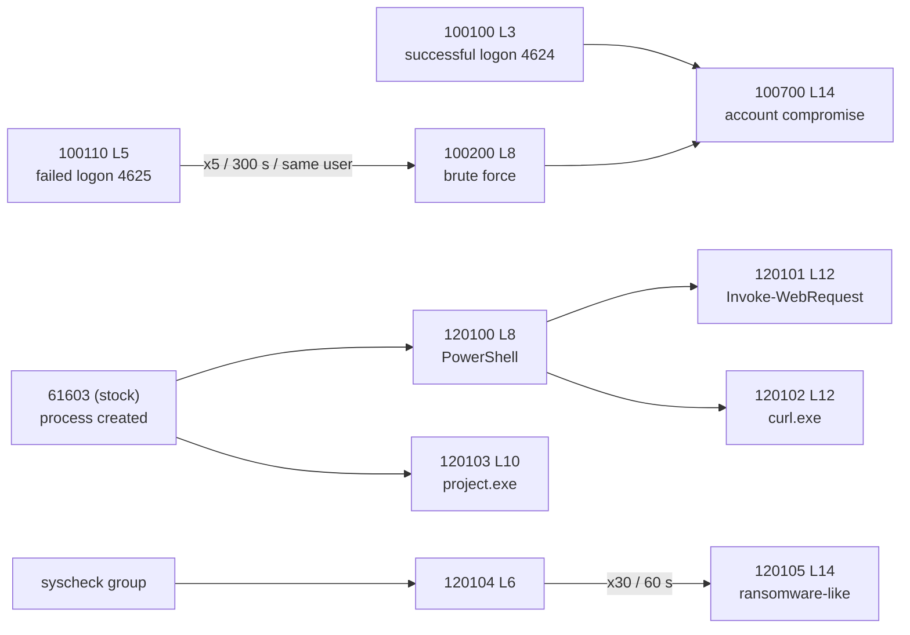

# Detection engineering

Custom rules grouped by platform and purpose. Rule IDs and logic are preserved from the project documentation; whitespace was normalized only. Deployable XML: [`detection-rules/`](../detection-rules/) (combined: [`local_rules.documented.xml`](../detection-rules/local_rules.documented.xml)).

Tags: **[Documented]**, **[Validated]** (shown firing in a scenario), **[Not recorded]**, **[Recommendation]**.

## Overview

| Purpose | Rule IDs | File |
|---|---|---|
| Windows authentication | 100110, 100200, 100100, 100700 | [`windows/authentication.xml`](../detection-rules/windows/authentication.xml) |
| Windows process / PowerShell | 120100-120103 (101100 disabled) | [`windows/process-and-powershell.xml`](../detection-rules/windows/process-and-powershell.xml) |
| Active Directory | 110152, 102020 | [`active-directory/account-and-group-changes.xml`](../detection-rules/active-directory/account-and-group-changes.xml) |
| FIM correlation | 120104, 120105 | [`fim/fim-correlation.xml`](../detection-rules/fim/fim-correlation.xml) |
| Linux | none custom (stock rules) | [`linux/README.md`](../detection-rules/linux/README.md) |

Severity convention (Wazuh): 3 low ... 15 critical. Telegram forwards level >= 8.

Rule chains:



---

## Windows - authentication

### 100110 - Windows: Failed logon attempt
| | |
|---|---|
| Event source | Windows Security log, Event ID 4625 |
| Logic | `if_group windows` AND `win.system.eventID` = `^4625$` |
| Relevant fields | `win.system.eventID`, `win.eventdata.targetUserName`, source IP fields |
| Severity | 5 |
| Expected alert | "Windows: Failed logon attempt" for every failed logon |
| Testing | `scripts/testing/windows-failed-logon-burst.ps1`; scenario 3 |

### 100200 - Windows: Brute force attempt detected **[Validated]**
| | |
|---|---|
| Event source | Derived from 100110 |
| Logic | `frequency=5`, `timeframe=300`, `if_matched_sid 100110`, `same_field win.eventdata.targetUserName` -> 5 failures for the same user in 300 s |
| Relevant fields | `win.eventdata.targetUserName` |
| Severity | 8 (meets the Telegram threshold) |
| Expected alert | "Windows: Brute force attempt detected - <user>" |
| Testing | Scenario 3 (brute-force phase); helper script above. Counting is per target user, not per source IP. |

### 100100 - Windows: Successful logon
| | |
|---|---|
| Event source | Event ID 4624 |
| Logic | `if_group windows` AND eventID `^4624$` |
| Severity | 3 |
| Expected alert | One informational alert per successful logon (high volume) |
| Testing | Any interactive or network logon on a monitored Windows host |

### 100700 - ACCOUNT COMPROMISE
| | |
|---|---|
| Event source | Derived from 100200 and 100100 |
| Logic | `timeframe=300`, `if_matched_sid 100200`, `if_sid 100100`, `same_field win.eventdata.targetUserName` (intent: success after brute force for the same user) |
| Severity | 14 |
| Expected alert | "ACCOUNT COMPROMISE" |
| Testing | Brute-force a *test* account to trigger 100200, then log in successfully with it within 300 s. |
| Caveat | Reproduced as recorded. It has no explicit `frequency` attribute and combines `if_matched_sid` with `if_sid`; no alert from it is shown in the validation scenarios. Validate with `wazuh-analysisd -t` and `wazuh-logtest` on your Wazuh version; it may need adjusting. |

## Windows - process and PowerShell

> All four rules depend on stock rule 61603. To the best of our knowledge that is the Sysmon "process created" rule, while the project mentions only Event ID 4688 (and lists Sysmon as future work). Verify the parent rule fires for your telemetry before trusting these rules. **[Recommendation]**

### 120100 - PowerShell execution detected
| | |
|---|---|
| Logic | `if_sid 61603` AND text contains `powershell.exe` |
| Severity | 8 |
| Expected alert | "PowerShell execution detected" |
| Testing | Launch PowerShell on a monitored host |

### 120101 - PowerShell download activity detected
| | |
|---|---|
| Logic | `if_sid 120100` AND text contains `Invoke-WebRequest` |
| Severity | 12 |
| Expected alert | "PowerShell download activity detected" |
| Testing | Scenario 2 delivery step (reported detected; the rule ID of that alert was not recorded) |

### 120102 - PowerShell spawned curl for payload download
| | |
|---|---|
| Logic | `if_sid 120100` AND text contains `curl.exe` |
| Severity | 12 |
| Expected alert | "PowerShell spawned curl for payload download" |

### 120103 - Suspicious executable launched
| | |
|---|---|
| Logic | `if_sid 61603` AND text contains `project.exe` |
| Severity | 10 |
| Expected alert | "Suspicious executable launched" |
| Note | Hard-coded to the lab test binary name; demonstrates the idea only. A generic approach is the unrecorded rule 101300 (execution from Temp/AppData/Downloads), which is the alert actually shown in the scenario. |

### 101100 - Windows: Encoded PowerShell command detected (**disabled**)
| | |
|---|---|
| Logic (as documented) | `if_sid 100900` AND `win.eventdata.commandLine` matches PCRE2 `(?i)(-enc|-encodedcommand|-e\s+[A-Za-z0-9+/=]{20,})` |
| Severity | 12 |
| Status | A "PowerShell detections" panel in the process dashboard screenshot lists 101100 (and a 101000), so a working version existed in the lab; its definition and its parent 100900 are **[Not recorded]**. The XML as documented is kept **commented out** in `process-and-powershell.xml`, because a missing parent SID prevents the analysis engine from starting. |
| To enable | Define 100900 (or point `if_sid` at an existing process-creation rule), ensure command lines are logged (see `configs/windows/ad-audit-policy.md`), test, then uncomment. |

## Active Directory

### 110152 - User created **[Validated]**
| | |
|---|---|
| Event source | Domain controller Security log, Event ID 4720 |
| Logic | `if_group windows` AND eventID `^4720$` |
| Relevant fields | `win.eventdata.targetUserName`, `win.eventdata.subjectUserName` |
| Severity | 10 |
| Expected alert | "User created" |
| Testing | `scripts/testing/windows-ad-user-group-test.ps1`; scenario 3 |

### 102020 - AD: User added to privileged group **[Validated]**
| | |
|---|---|
| Event source | Event IDs 4728, 4732, 4756 |
| Logic | `if_group windows` AND eventID `^4728$|^4732$|^4756$` |
| Severity | 12 |
| Expected alert | "AD: User added to privileged group" |
| Testing | Test script above (dedicated group); scenario 3 (privileged group, Atomic Red Team T1098) |
| Caveat | The logic matches additions to *any* security group of those scopes, not only privileged groups. Filter by group name for production-like use. |

## FIM correlation

### 120104 - FIM file modification detected
| | |
|---|---|
| Logic | `if_group syscheck` (every FIM event) |
| Severity | 6 |
| Expected alert | One alert per FIM event |

### 120105 - Possible ransomware activity **[Validated]**
| | |
|---|---|
| Logic | `frequency=30`, `timeframe=60`, `if_matched_sid 120104` -> 30 FIM events in 60 s |
| Severity | 14 |
| Expected alert | "Possible ransomware activity - multiple file modifications detected in a short time" |
| Testing | `scripts/testing/windows-fim-burst.ps1`; scenario 1 |
| Caveat | Not scoped per agent or path: legitimate bulk changes (updates, backups) can trigger it. |

## Referenced but not recorded **[Not recorded]**

These IDs appear in dashboard or scenario descriptions, but their XML was not available. They are deliberately **not** recreated here.

| Rule ID | Referenced purpose |
|---|---|
| 100111 | RDP authentication failure |
| 100900 | Process-creation monitoring (parent of 101100) |
| 101000 / 101002 | PowerShell detections (101000 appears only in the dashboard screenshot legend); 101002 = suspicious execution indicators |
| 101200 | Suspicious LOLBin execution (certutil, mshta, rundll32) |
| 101201 | LOLBins used for remote download/execution |
| 101300 | Process launched from suspicious directory (Temp, AppData, Downloads) - shown firing in scenario 2 |
| 110100 / 110101 / 110102 | GPO modified / created / possibly deleted |
| 110153 | AD user deleted |
| (unnamed) | "Kill chain confirmed" counter on the process dashboard (value 0 in the screenshot); logic not recorded |

## Stock rules relied on

5700 / 5715 (sshd success), the sshd failure family, 5902 (new user), syscheck rules for file/registry changes. Not custom; listed for completeness.

## [Recommendation] Test every rule offline first

```bash
sudo /var/ossec/bin/wazuh-logtest      # paste a sample event; confirm the decoder, rule ID and level
sudo /var/ossec/bin/wazuh-analysisd -t # syntax and dependency check before restarting
```
