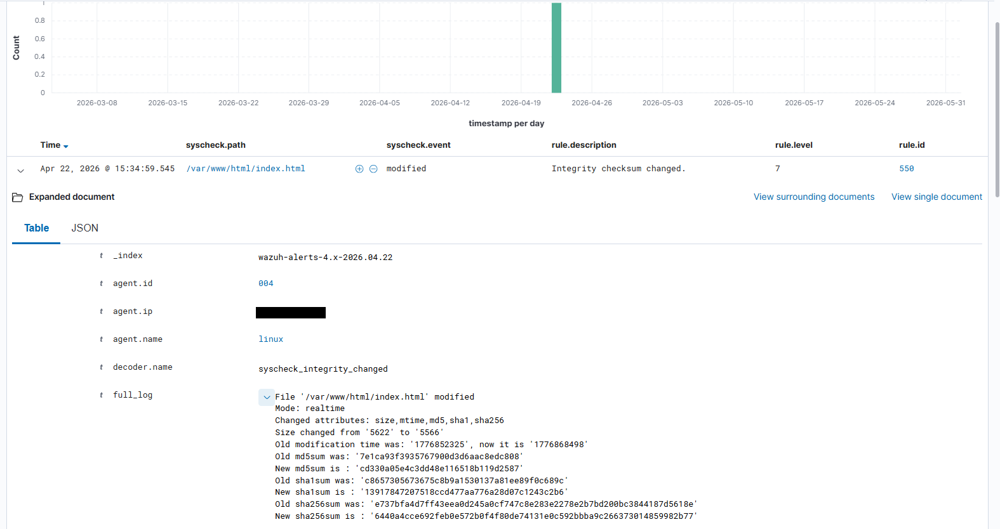

# Testing and validation

## Approach **[Documented]**

After deployment, three attack scenarios were run in the isolated lab to check that Wazuh detects the activity, raises alerts and notifies the analyst. Scenarios were mapped to MITRE ATT&CK and verified through Wazuh alerts, dashboards, FIM events and Telegram notifications. In this repository the first scenario is split into two folders (delivery/execution/persistence and impact).

## Results as recorded **[Validated]**

| Scenario | Check | Alert(s) shown | Result |
|---|---|---|---|
| 1-2 Ransomware chain | Payload download via PowerShell | rule ID not recorded | Detected |
| | Execution from suspicious directory | 101300 "Windows: Process launched from suspicious directory" | Detected |
| | Persistence in `HKCU\...\Run` | FIM registry alert (ID not recorded) | Detected |
| | Mass file modification | 120105 "Possible ransomware activity..." (level 14) | Detected |
| 3 AD compromise | Brute force | 100200 "Windows: Brute force attempt detected" | Detected |
| | New domain user | 110152 "User Created" | Detected |
| | Privileged group membership | 102020 "AD: User added to privileged group" | Detected |
| 4 Linux SSH | SSH brute force | stock PAM alert "Multiple failed logins in a small period of time" (ID not visible) | Detected |
| | New local account | 5902 "New user added to the system" | Detected |
| All | Telegram notifications | - | Delivered |

Evidence is provided as sanitized screenshots (IPs, hostnames, domains and account names redacted), indexed in [`screenshots/README.md`](../screenshots/README.md) and embedded in each scenario README. Example: a FIM alert (rule 550, level 7) for a modified web-root file, with the hash diff recorded:

You can also reproduce the scenarios yourself with the helpers below and compare.

## How to reproduce safely **[Recommendation]**

Use the helpers in [`scripts/testing/`](../scripts/testing/). They generate the *telemetry* each rule expects with benign actions (test account, dummy files, a harmless registry value) and refuse to run without a lab confirmation.

| Detection | Helper | Expected |
|---|---|---|
| Brute force (Windows) | `windows-failed-logon-burst.ps1` | 100110 x N, then 100200 |
| AD user + group | `windows-ad-user-group-test.ps1` | 110152, 102020 |
| Run-key persistence | `windows-run-key-test.ps1` | FIM registry alert |
| Mass file changes | `windows-fim-burst.ps1` | 120104 x N, then 120105 |
| SSH failures | `linux-failed-ssh-burst.sh` | stock sshd failure alerts |
| New Linux account | `linux-create-test-user.sh` | 5902 (+ FIM on `/etc/passwd`) |
| Telegram | `test-telegram-integration.sh` | message in the chat |

## Pre-flight checklist **[Recommendation]**

1. Agents Active in the dashboard; clocks in sync (NTP) on all hosts.
2. Audit policies applied (`gpupdate /force` on the DC), command-line auditing enabled if you rely on command-line rules.
3. `wazuh-analysisd -t` passes after deploying rules.
4. Test the rule in `wazuh-logtest` with a sample event before generating real traffic.
5. Take a VM snapshot before each scenario so the lab can be reverted.

## Atomic Red Team (scenario 3) **[Documented]**

The project ran `Invoke-AtomicTest T1098` to simulate account manipulation in a controlled, repeatable manner; the evidence shows test T1098-2 (*Domain Account and Group Manipulate*) executing. Install and use Atomic Red Team per its own documentation, in the lab only, and run the matching cleanup (`Invoke-AtomicTest T1098-2 -Cleanup`) afterwards **[Recommendation]**.

## What was not measured

- Detection latency (event to alert to Telegram).
- False-positive rate or alert volume on normal activity.
- Behavior under load or with more than three agents.
- Repeatability across runs (single execution per scenario).
- Evasion resistance (the attacks were deliberately simple).
